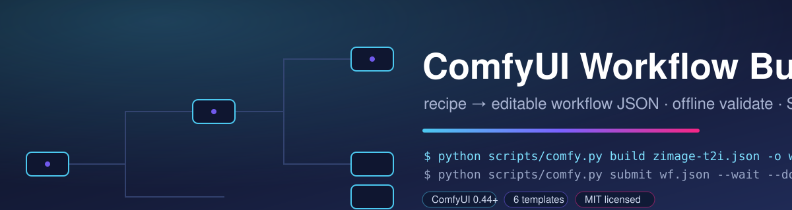

<div align="center">



# ComfyUI Workflow Builder

**把「一句话需求」变成能在你的 ComfyUI 上跑通、还能继续编辑的 workflow JSON。**

[](LICENSE)
[](https://www.python.org/)
[](https://github.com/comfyanonymous/ComfyUI)
[](https://github.com/chunlinsong42-web/comfyui-workflow-builder)
[](CONTRIBUTING.md)

[特性](#-特性) · [快速开始](#-快速开始) · [示例](#-示例) · [命令](#-命令) · [架构](#-架构) · [文档](#-文档) · [FAQ](#-faq)

</div>

---

## ✨ 特性

| | |
|---|---|
| 🧱 **recipe DSL** | 约 20 行 JSON 描述一个工作流；`build` 自动算 slot、连线、布局，生成 **ComfyUI UI 0.4 格式**（可拖拽、可继续编辑） |
| ✅ **离线校验** | `validate` 检查节点类型、连线、必填输入、COMBO 合法性；不连 GPU 也能改工作流 |
| 🔁 **UI ↔ API 互转** | `convert` 把 UI 工作流转成 `/prompt` 提交格式，正确处理 `widgets_values_named` 与种子后的 `control_after_generate` |
| 🚀 **一键执行** | `submit --wait --download`：排队、等待、下载产物；`--seed` 统一改种子 |
| 🔌 **SSH 隧道** | 远端只监听 `127.0.0.1:6006` 也能用；keepalive + 断线自动重连 |
| 🧩 **子图展开** | `inspect` 展开 `definitions.subgraphs`，读懂官方/别人的模板 |
| 📚 **12 类管线模板** | 图像、视频、音频、放大、编辑、对口型…从 150 个真实工作流 + 766 个官方模板蒸馏 |
| 🤖 **Agent 友好** | `SKILL.md` 入口，DSH / Claude Code / Codex / Cursor 等可直接加载 |

## 🚀 快速开始

### 1. 安装

```bash
# 作为 DSH 技能
git clone https://github.com/chunlinsong42-web/comfyui-workflow-builder.git \
  ~/.dsh/skills/comfyui-workflow-builder

# 依赖（只有 SSH 功能需要 paramiko）
cd ~/.dsh/skills/comfyui-workflow-builder
pip install -r requirements.txt
```

> 也可以用 Release 里的 zip 解压到 `~/.dsh/skills/`；Claude Code / Codex 等把目录放进各自的 skills 目录即可。

### 2. 配置你的 ComfyUI

```bash
cp instance.example.json instance.json
# 编辑 host / port / user / password（或改用环境变量，见下）
```

```bash
python scripts/comfy.py tunnel      # 本地 16006 → 远端 127.0.0.1:6006，常驻
python scripts/comfy.py stats       # 期望: ComfyUI 0.44.0 | RTX 5090 | 33.7 GB
python scripts/comfy.py catalog     # 抓 /object_info 到 .cache（离线校验用）
```

环境变量（优先级高于 `instance.json`）：
`COMFY_SSH_HOST` · `COMFY_SSH_PORT` · `COMFY_SSH_USER` · `COMFY_SSH_PASSWORD` ·
`COMFY_TUNNEL_PORT` · `COMFY_REMOTE_PORT` · `COMFY_BASE_URL`（ComfyUI 可直连时跳过隧道）

### 3. 跑第一个工作流

```bash
python scripts/comfy.py build templates/zimage-t2i.json -o wf.json
python scripts/comfy.py validate wf.json
python scripts/comfy.py submit wf.json --wait --download out
```

## 🧪 示例

```json
{
  "title": "Zimage 文生图",
  "annotate": true,
  "nodes": {
    "unet":   {"type": "UNETLoader", "widgets": {"unet_name": "Zimage/z_image_turbo_bf16.safetensors"}},
    "clip":   {"type": "CLIPLoader", "widgets": {"clip_name": "qwen_3_4b.safetensors", "type": "qwen_image"}},
    "vae":    {"type": "VAELoader", "widgets": {"vae_name": "z_image_vae.safetensors"}},
    "latent": {"type": "EmptyLatentImage", "widgets": {"width": 720, "height": 1280}},
    "pos":    {"type": "CLIPTextEncode", "widgets": {"text": "一名亚洲女生，晨光，写实人像"}},
    "neg":    {"type": "CLIPTextEncode", "widgets": {"text": "低分辨率，模糊"}},
    "sampler":{"type": "KSampler", "widgets": {"seed": 42, "steps": 8, "cfg": 1,
                                                "sampler_name": "euler", "scheduler": "simple", "denoise": 1}},
    "decode": {"type": "VAEDecode"},
    "save":   {"type": "SaveImage", "widgets": {"filename_prefix": "%date:yyyyMMdd%/image_"}}
  },
  "links": [
    "unet.MODEL -> sampler.model",
    "clip.CLIP -> pos.clip", "clip.CLIP -> neg.clip",
    "latent.LATENT -> sampler.latent_image",
    "pos.CONDITIONING -> sampler.positive", "neg.CONDITIONING -> sampler.negative",
    "sampler.LATENT -> decode.samples",
    "vae.VAE -> decode.vae", "decode.IMAGE -> save.images"
  ]
}
```

| Zimage Turbo（512×768 / 6 步 / 48.6s） | Krea2 Turbo（768×1024 / 8 步 / 42.6s） |
|---|---|
|  |  |

## 🛠 命令

| 命令 | 说明 |
|---|---|
| `tunnel` | SSH 本地端口转发（keepalive 20s，断线自动重连） |
| `stats` | ComfyUI 版本 / GPU / 显存 |
| `catalog` | 拉取 `/object_info` 到 `.cache/object_info.json` |
| `nodes <关键词>` | 查节点签名与可选模型名 |
| `build <recipe> -o wf.json` | recipe → UI 0.4 工作流 |
| `validate <wf.json>` | 类型、连线、必填、COMBO 检查 |
| `convert <wf.json>` | UI → API prompt（`/prompt` 用） |
| `inspect <wf.json>` | 展开子图，打印真实节点链与控件 |
| `submit <wf.json> --wait --download DIR` | 执行并取回产物；`--seed` 覆盖种子 |
| `queue` / `interrupt` | 队列状态 / 中断当前任务 |

SSH 辅助：

```bash
python scripts/remote.py run "ls /path/to/ComfyUI/user/default/workflows"
python scripts/remote.py get <远端文件> ./ref.json
python scripts/remote.py put ./wf.json "<远端分类>/name.json"
```

## 🧩 架构

```mermaid
flowchart LR
  A[recipe.json] -->|build| B[workflow.json<br/>UI 0.4]
  B -->|validate| C{离线校验}
  C -->|通过| D[convert]
  D --> E[(POST /prompt)]
  E --> F[/history/]
  F --> G[/view 下载]
  C -->|报错| H[分类修复<br/>连接/参数/结构/资源]
  H --> A
  O[(/object_info)] -.->|签名/默认值/COMBO| A
  O -.-> C
```

- **交付 UI 格式**，不是只能提交的 API JSON —— 用户能在 ComfyUI 前端继续改。
- **`/object_info` 是唯一事实来源**：节点名、模型名、默认值、min/max、slot 全部实时读取。
- **自动修复循环**：连接/参数/结构/资源四类，最多 5 轮（[error-autofix.md](references/error-autofix.md)）。

## 📚 文档

| 文档 | 内容 |
|---|---|
| [SKILL.md](SKILL.md) | Agent 入口：流程、铁律、命令、模型选择 |
| [instance.md](references/instance.md) | 配置、目录、参考实例、离线处理 |
| [workflow-format.md](references/workflow-format.md) | UI 0.4 / API JSON 规范、控件与种子规则、子图位置 |
| [patterns.md](references/patterns.md) | 13 类管线模板（图像/视频/音频/放大/编辑/官方对照） |
| [official-templates.md](references/official-templates.md) | 官方 766 个模板学习笔记（子图、展开链路、参数对照） |
| [node-catalog.md](references/node-catalog.md) | 485 个常用节点签名 |
| [workflow-index.md](references/workflow-index.md) | 参考实例 150 个工作流索引 |
| [vram-and-samplers.md](references/vram-and-samplers.md) | 显存预算、模型参数、采样器速查 |
| [troubleshooting.md](references/troubleshooting.md) / [error-autofix.md](references/error-autofix.md) | 排错与 5 轮修复循环 |
| [github-digest.md](references/github-digest.md) | 与上游技能的设计取舍 |
| [templates/](templates/) | 6 个 recipe 起点 |

## ✅ 兼容性

- 在 **ComfyUI 0.44.0 / 前端 1.58.5** 实测；UI 0.4 格式对 0.3.x+ 基本通用。
- Python **3.9+**；提交端只用标准库，SSH 需要 `paramiko>=3.4`。
- 需要 ComfyUI 暴露 HTTP API（默认 6006）且 SSH 可达；也可用 `COMFY_BASE_URL` 直连。
- 官方模板（766 个）已学习并对照，见 [official-templates.md](references/official-templates.md)。

## 🔒 安全

- 仓库**不含**任何凭据；`instance.json`、`.cache/` 已在 `.gitignore` 中。
- 建议用环境变量传密码，或改用 SSH key（`remote.py` 可自行替换认证方式）。
- 只在你拥有/获授权的实例上使用；模型与生成内容许可由使用者负责。

## ❓ FAQ

<details>
<summary><b>必须用 SSH 隧道吗？</b></summary>

不用。若 ComfyUI 已暴露在可直连地址，设 `COMFY_BASE_URL=http://host:6006` 后跳过 `tunnel` 即可。
</details>

<details>
<summary><b>模板里的模型名在我机器上不存在怎么办？</b></summary>

`build/validate` 会报 `value_not_in_list`，用 `python scripts/comfy.py nodes UNETLoader` 查你机器上的真实文件名，
替换 recipe 里的 `widgets` 即可；节点链本身通用。
</details>

<details>
<summary><b>能处理官方/别人的子图模板吗？</b></summary>

能读不能直接 build。用 `python scripts/comfy.py inspect wf.json` 展开子图看链路，再按 [patterns.md](references/patterns.md)
用 recipe 重建，或直接复制原模板改参数提交。
</details>

<details>
<summary><b>支持视频/音频吗？</b></summary>

支持：Wan2.2（原生 + WanVideoWrapper）、LTX2.5、MiniMax-H3、Qwen3-TTS、ACE-Step、SeedVR2 放大等，
见 [patterns.md](references/patterns.md)。
</details>

<details>
<summary><b>为什么没有把 6,619 个节点全写进文档？</b></summary>

节点随自定义包变化，文档只保留 485 个高频节点签名；完整目录用 `catalog` 现抓，`nodes` 现查。
</details>

## 🗺 Roadmap

- [x] recipe DSL + build/validate/convert/submit
- [x] SSH 隧道自动重连、离线缓存
- [x] 官方 766 模板学习与子图展开（`inspect`）
- [ ] 子图 → 扁平节点的自动展开（`flatten`）
- [ ] 模板模型名一键替换（按目标实例 catalog）
- [ ] GitHub Actions：模板 JSON / SKILL frontmatter / 脚本编译 CI

## 🙏 致谢

- [Comfy-Org/workflow_templates](https://github.com/Comfy-Org/workflow_templates) — 官方 766 个模板（学习素材）
- [LingyiChen-AI/comfyui-workflow-skill](https://github.com/LingyiChen-AI/comfyui-workflow-skill)（MIT）
- [21Pdontno/comfyui-workflow-skills](https://github.com/21Pdontno/comfyui-workflow-skills)（MIT）

## License

[MIT](LICENSE) © comfyui-workflow-builder contributors

<div align="center"><sub>If this skill saves you time, a ⭐ helps others find it.</sub></div>
